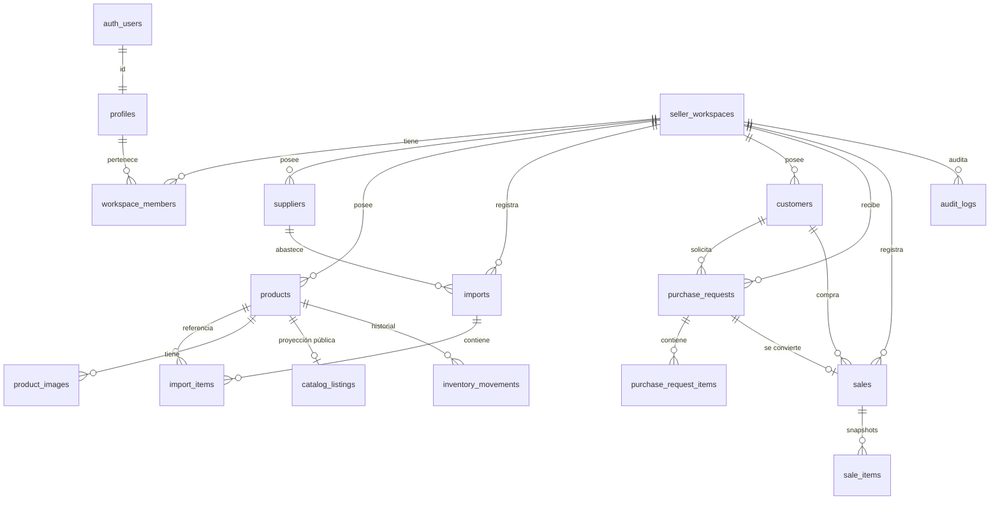
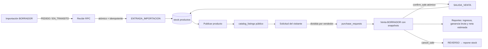

# ImportHub — Marketplace multi-vendedor para importadores

Prototipo académico de un sistema web para pequeños negocios que importan productos,
los ingresan a su inventario y los venden a través de un marketplace público
multi-vendedor. **Español (es-BO), zona America/La_Paz, moneda BOB (configurable).**

> ⚠️ Prototipo de gestión: no genera facturación fiscal, logística aduanera ni
> contabilidad legal. Los reportes de utilidad son **estimaciones administrativas**.

## Stack

- **Next.js 15 (App Router) + React 19 + TypeScript estricto**
- **Tailwind CSS** con componentes accesibles propios (equivalentes a shadcn/ui)
- **Supabase** (PostgreSQL + Auth + Storage), cliente SSR oficial con cookies
- **Zod** (validación compartida) + **React Hook Form**
- **Recharts** (gráficos)
- **Vitest** (unitarias) + **Playwright** (E2E) + pruebas RLS con supabase-js

## Arquitectura en una mirada

- **Multiempresa real**: una sola base; cada negocio es un `seller_workspace`.
  Las cinco tiendas del demo son filas, no bases separadas.
- **Dos ámbitos separados**: el público lee únicamente `catalog_listings`
  (proyección sin costos, stock exacto, proveedores ni márgenes); el vendedor
  opera sus datos privados con RLS por `workspace_id`.
- **Autorización en capas**: middleware (sesión) → Server Actions (membresía
  resuelta en servidor desde `workspace_members`) → **RLS** como segunda barrera.
- **Dinero sin floats**: `numeric(14,2)` en PostgreSQL; centavos enteros en TS.
- **Operaciones críticas atómicas e idempotentes** en funciones PL/pgSQL
  (recibir importación, confirmar/anular venta, publicar, solicitudes públicas).

## Requisitos

- Node.js 20+
- Docker (para Supabase local) **o** un proyecto Supabase en la nube
- Supabase CLI: `npm i -g supabase` (opcional pero recomendado)

## Instalación local (Supabase local)

```bash
# 1. Dependencias (genera package-lock.json reproducible)
npm install

# 2. Levantar Supabase local (PostgreSQL + Auth + Storage + Studio)
npx supabase start

# 3. Aplicar migraciones y seed (5 vendedores + datos de demo)
npx supabase db reset

# 4. Variables de entorno
cp .env.example .env.local
# Rellena con los valores que imprime `npx supabase status`:
#   NEXT_PUBLIC_SUPABASE_URL=http://127.0.0.1:54321
#   NEXT_PUBLIC_SUPABASE_ANON_KEY=<anon key local>

# 5. Ejecutar
npm run dev   # http://localhost:3000
```

## Instalación contra un proyecto Supabase remoto

```bash
npm install
npx supabase link --project-ref <tu-ref>
npx supabase db push                 # aplica migraciones 0001-0005

# Usuarios demo vía Admin API (service_role SOLO en servidor):
cp .env.example .env.local   # rellena URL, anon key y SUPABASE_SERVICE_ROLE_KEY
node scripts/seed.mjs

# Datos de demostración:
psql "$DATABASE_URL" -f supabase/seed.sql
```

## Credenciales demo (cámbialas fuera de demo)

| Espacio | Correo | Contraseña |
|---|---|---|
| Andes Import (tecnología) | `vendedor1@demo.importhub.test` | `Demo-2026!` |
| Paceña Home (hogar) | `vendedor2@demo.importhub.test` | `Demo-2026!` |
| Altiplano Kids (juguetes) | `vendedor3@demo.importhub.test` | `Demo-2026!` |
| Chaco Tools (herramientas) | `vendedor4@demo.importhub.test` | `Demo-2026!` |
| AVÉLI (varios) | `aveli@demo.importhub.test` | `Aveli-2026!` |

## Scripts

| Comando | Descripción |
|---|---|
| `npm run dev` | Desarrollo |
| `npm run build` / `npm start` | Build y servidor de producción |
| `npm run lint` | ESLint |
| `npm run typecheck` | TypeScript estricto |
| `npm run test` | Pruebas unitarias (Vitest) |
| `npm run test:rls` | Pruebas de políticas RLS (requiere Supabase + seed) |
| `npm run test:e2e` | Pruebas E2E (requiere app + Supabase + seed) |
| `npm run check` | lint + typecheck + unit tests + build |
| `npm run seed` | Crea usuarios demo en un proyecto remoto |

## Pruebas E2E

```bash
npx playwright install chromium   # una sola vez
npx supabase start && npx supabase db reset
npm run test:e2e                  # levanta `npm run dev` automáticamente
```

Cubre: login/logout, redirección de rutas privadas, aislamiento entre
vendedores (URL/UUID ajenos), catálogo público sin datos internos, división
del carrito en dos solicitudes, recepción de importación idempotente,
publicar/despublicar, venta que descuenta stock y anulación con reverso, y
rechazo de venta mayor al stock.

## Rutas

```text
/                                    Marketplace (público)
/catalogo                            Catálogo paginado con filtros
/catalogo/[slug]                     Ficha pública de producto
/carrito                             Carrito + solicitud de compra
/solicitud/confirmacion/[codigo]     Confirmación con códigos públicos
/ingresar                            Login vendedores
/dashboard                           Resumen (tarjetas + gráficos)
/dashboard/importaciones             Proveedores→pedidos→recepción
/dashboard/proveedores
/dashboard/productos                 Productos + publicación
/dashboard/inventario                Stock + movimientos inmutables
/dashboard/solicitudes               Solicitudes del marketplace
/dashboard/ventas                    Ventas con snapshots
/dashboard/clientes                  Libreta privada + historial
/dashboard/reportes                  Rentabilidad + CSV
```

## Modelo de datos (Mermaid)



## Flujo importación → inventario → venta → reporte (Mermaid)



## Matriz de permisos por rol y recurso

| Recurso | Visitante (anon) | seller_owner | platform_admin |
|---|---|---|---|
| `catalog_listings` (público) | **Leer** | Leer | Leer |
| Crear solicitud de compra | **Sí** (vía RPC + rate limit) | Sí | Sí |
| `products` (privado) | ❌ | CRUD propio espacio | ❌ (sin pantalla de datos) |
| `suppliers` / `imports` / `import_items` | ❌ | CRUD propio espacio | ❌ |
| `inventory_movements` | ❌ | Leer propio (escritura solo vía funciones) | ❌ |
| `customers` | ❌ | CRUD propio espacio | ❌ |
| `purchase_requests(_items)` | Crear vía RPC | Leer + cambiar estado propios | ❌ |
| `sales` / `sale_items` | ❌ | Leer propio; crear/confirmar/anular vía funciones | ❌ |
| `audit_logs` | ❌ | Leer propio | Leer |
| `seller_workspaces` | ❌ | Leer/editar nombre del propio | Crear/desactivar |
| `workspace_members` | ❌ | Leer membresías de su espacio | Gestionar (vía service_role) |
| Storage `product-images` (público) | Leer | Subir/borrar solo en su carpeta `<workspace_id>/…` | — |
| Storage `private-docs` (privado) | ❌ | Leer/escribir su carpeta con URLs firmadas | — |

## Seguridad (resumen)

- RLS activado en todas las tablas; políticas separadas por operación.
- El `workspace_id` jamás se acepta del navegador: se resuelve desde
  `workspace_members` en el servidor; los esquemas Zod `.strict()` rechazan
  campos inesperados.
- Rate limiting en memoria para login (5/min) y solicitudes públicas (10/h).
  Para producción multi-instancia, sustituir `src/lib/rate-limit.ts` por un
  store compartido (Upstash/Redis) — la firma `consume()` no cambia.
- Encabezados CSP, `X-Frame-Options: DENY`, `nosniff`, `Referrer-Policy`.
- Imágenes públicas: bucket público con MIME y tamaño limitados (2 MB);
  documentos privados: bucket privado con URLs firmadas.
- `service_role` solo en `scripts/seed.mjs` (servidor); nunca en el bundle
  del cliente ni en el repositorio (`.env*` en `.gitignore`).
- Auditoría en `audit_logs` de: publicación, ajustes, recepción de
  importación, confirmación/anulación de ventas.

## Solución de problemas

| Problema | Solución |
|---|---|
| `Invalid API key` al abrir la app | Verifica que `.env.local` tenga la URL y anon key de `npx supabase status` |
| Login dice "Credenciales incorrectas" | Ejecuta `npx supabase db reset` para sembrar los usuarios demo |
| El catálogo aparece vacío | Aplica el seed (`db reset`); publica productos desde el panel |
| Error de CORS/ CSP en imágenes | Agrega tu dominio Supabase a `images.remotePatterns` en `next.config.mjs` |
| E2E no encuentra navegadores | `npx playwright install chromium` |
| Recuperación de contraseña no envía correo | En local, revisa Inbucket (`http://127.0.0.1:54324`); en remoto configura SMTP |

## Despliegue

1. Crea el proyecto en Supabase y aplica migraciones (`db push`).
2. Despliega en Vercel con las variables de entorno de `.env.example`
   (sin `SUPABASE_SERVICE_ROLE_KEY`, salvo que ejecutes el seed).
3. Configura `NEXT_PUBLIC_SITE_URL` con tu dominio para sitemap/OG.
